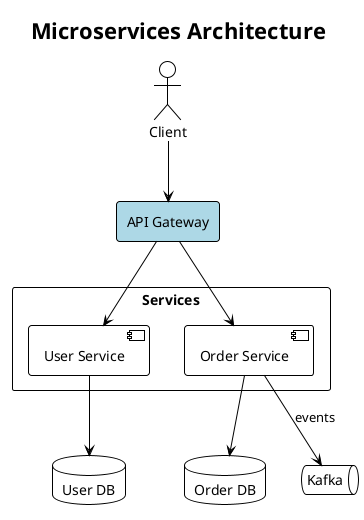
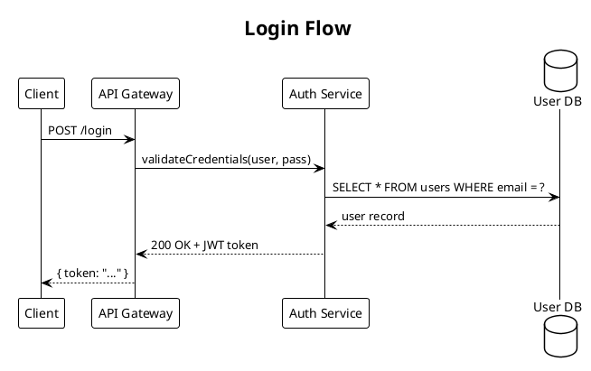
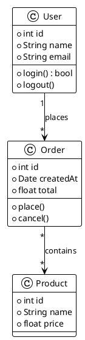
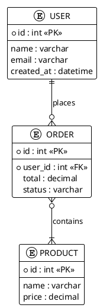
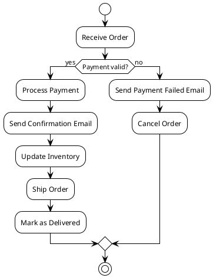
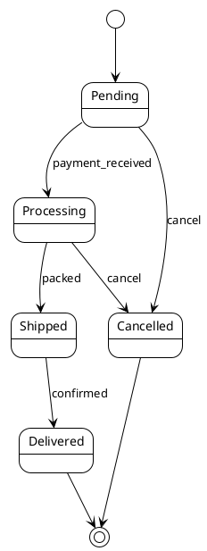
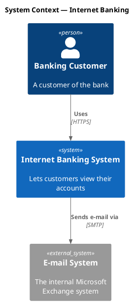

# Diagram syntax cookbook

Load the relevant example when generating or editing diagram syntax. Render and
validate through [the shared workflow](../SKILL.md#workflow).

## Component / Architecture Diagram

**Shape types:**
- `actor "Name" as id` — stick figure (user, external actor)
- `component "Name" as id` — component box with [brackets]
- `rectangle "Name" as id` — plain rectangle (for groups/layers)
- `database "Name" as id` — cylinder (database)
- `queue "Name" as id` — queue symbol
- `cloud "Name" as id` — cloud shape (external services)
- `node "Name" as id` — server/node box
- `frame "Name" as id` — frame grouping
- `package "Name" { }` — package grouping

**Arrows:**
- `A --> B` — solid arrow
- `A -> B` — thin arrow
- `A ..> B` — dashed arrow
- `A --> B : label` — labeled arrow
- `A <--> B` — bidirectional

**Colors:**
- `#LightBlue`, `#LightGreen`, `#LightYellow`, `#Pink`, `#Violet`
- `#AED6F1` (blue), `#A9DFBF` (green), `#FAD7A0` (orange), `#F1948A` (red)
- `#D7BDE2` (purple), `#F9E79F` (yellow), `#D3D3D3` (grey)

## Sequence Diagram

**Arrow types:**
- `A -> B` — synchronous call
- `A --> B` — return / dashed
- `A ->> B` — async message
- `A -[#red]-> B` — colored arrow
- `activate A` / `deactivate A` — show activation box

## Class Diagram

**Relationships:**
- `A --> B` — association
- `A --|> B` — inheritance
- `A ..|> B` — implements interface
- `A *-- B` — composition
- `A o-- B` — aggregation
- `A "1" --> "*" B : label` — with multiplicities

## ER Diagram

## Activity / Flowchart

## State Diagram

## C4 Context Diagram

C4 uses the bundled C4-PlantUML standard library via `!include <C4/...>`, which Kroki and recent local jars resolve with no network fetch. Export with the **standard** `plantuml` endpoint (the `c4plantuml` Kroki type also works).

Other levels: `<C4/C4_Container>` (`Container`, `ContainerDb`), `<C4/C4_Component>` (`Component`). Common macros: `Person`, `System`, `System_Ext`, `Container`, `Rel`, `Boundary`. **Do not** use a remote `!includeurl https://…` — Kroki cannot fetch external URLs; always use the bundled `<C4/…>` form.
